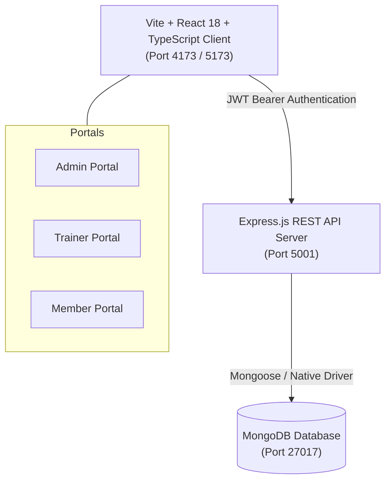
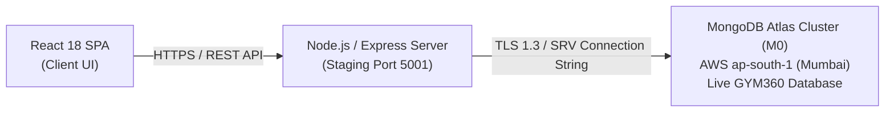

# GYM360 &bull; Enterprise Gym & Fitness Management Platform

[](https://www.typescriptlang.org/)
[](https://react.dev/)
[](https://nodejs.org/)
[](https://expressjs.com/)
[](https://www.mongodb.com/)
[](https://tailwindcss.com/)
[](https://vitejs.dev/)

**GYM360** is a full-stack, enterprise-grade gym and fitness center management ecosystem built with React 18, Node.js, Express, TypeScript, and MongoDB. It features real-time multi-tenant operations, 3 tailored role portals (Admin, Trainer, Member), automated billing with GST tax invoice generation, full database-synchronized CRUD operations, luxury dark/light mode, and single-sheet universal data export.

---

## 📑 Table of Contents

- [Key Features](#-key-features)
- [System Architecture](#-system-architecture)
- [Folder & Project Structure](#-folder--project-structure)
- [Prerequisites & Requirements](#-prerequisites--requirements)
- [Quick Start Guide](#-quick-start-guide)
- [Default Login Credentials](#-default-login-credentials)
- [API Reference](#-api-reference)
- [Database Models](#-database-models)
- [Cloud Deployment (MongoDB Atlas)](#-cloud-deployment-mongodb-atlas)
- [Verification & Testing](#-verification--testing)
- [Contributors & License](#-contributors--license)

---

## 🌟 Key Features

### 1. 🛡️ Role-Based Access Portals
- **Administrator Dashboard:** Complete oversight over all facilities, branches, members, trainers, equipment inventory, maintenance schedules, and audit trails.
- **Trainer Portal:** Personal scheduling hub, client assignments, 1-on-1 coaching sessions, and workout progression regimens.
- **Member Self-Service Hub:** Front-desk turnstile check-in pass, active membership status, workout plans, and personalized notifications.

### 2. 💳 Financials & Billing Center
- **Printable PDF Tax Invoices & Receipts:** Generate official GST invoices for every transaction, featuring official gym branding, GSTIN, SAC codes, itemized taxable subtotal, CGST (9%), SGST (9%), and a `PAID & VERIFIED` watermark. Supports native 1-click browser printing and PDF download (`window.print()`).
- **Automated Expiration Alerts & 1-Click Renewal:** Dashboard alerts notify members when their subscription expires in $\le 14$ days, enabling instant 1-click renewals with zero facility downtime.

### 3. 🔄 Real-Time Database Synchronized CRUD
- Full **Add & Remove (Delete)** capabilities across all 10 core entities (Members, Plans, Branches, Trainers, Equipment, Payments, Memberships, Maintenance Logs, Notifications, Attendance).
- Deleting an entry in the frontend permanently removes it from the MongoDB database (`deleteOne`), and changes made directly to the database reflect instantly in the app via query cache invalidation.

### 4. 🌗 Luxury Dark & Light Mode
- High-contrast, theme-swapping engine with persistent `localStorage` preference.
- Tailored for high-end fitness facilities with deep slate dark palettes and accessible contrast ratios.

### 5. 📊 Master Single-Sheet CSV Data Export
- Unified master data export generating a consolidated `.csv` file containing all members, branches, plans, equipment, payments, and attendance logs.

### 6. 🔐 Authentication & Password Recovery
- Secure JWT-based session management, bcrypt password hashing, role guard middlewares, and dedicated **Forgot Password & Reset Token** workflow.

---

## 🏗️ System Architecture



---

## 📁 Folder & Project Structure

The codebase is organized into cleanly decoupled, typed frontend and backend packages:

```
gym360/
├── .gitignore                    # Universal Git ignore rules
├── .env.example                  # Environment configuration template
├── README.md                     # Complete project documentation
├── backend/                      # Node.js + Express + TypeScript API Server
│   ├── package.json              # Backend dependencies & build scripts
│   ├── tsconfig.json             # TypeScript compiler configuration
│   ├── .env.staging              # Staging environment variables
│   ├── scripts/                  # Automation & verification scripts
│   │   ├── startStaging.js       # Production-mode staging launcher
│   │   ├── sync_staging.js       # MongoDB synchronization script
│   │   ├── test_financials.js    # Financials & invoice test suite
│   │   └── test_crud_all.js      # End-to-end CRUD verification suite
│   └── src/
│       ├── config/               # Database connection & environment setup
│       ├── controllers/          # Express route controllers
│       ├── middleware/           # Auth, RBAC, tenant, and error middleware
│       ├── models/               # MongoDB schema definitions
│       ├── routes/               # API route definitions
│       ├── services/             # Core business logic services
│       ├── types/                # TypeScript interfaces & DTOs
│       └── utils/                # Date, validation, and security utilities
└── frontend/                     # React 18 + Vite + Tailwind Client
    ├── package.json              # Frontend dependencies
    ├── vite.config.ts            # Vite bundler configuration
    ├── tailwind.config.js        # Tailwind CSS theme configuration
    ├── tsconfig.json             # Frontend TypeScript configuration
    └── src/
        ├── api/                  # Axios/Fetch API client functions
        ├── components/           # Reusable UI component library
        │   ├── attendance/       # Check-in & turnstile dialogs
        │   ├── common/           # ConfirmDeleteModal, Header, Sidebar
        │   ├── equipment/        # Asset modals
        │   ├── member/           # Member enrollment & status modals
        │   ├── membership/       # RenewModal & cancellation modals
        │   ├── payment/          # InvoiceModal & payment recorders
        │   └── trainer/          # Trainer scheduling modals
        ├── hooks/                # TanStack React Query custom hooks
        ├── pages/                # Route view components
        │   ├── admin/            # Admin management pages
        │   ├── auth/             # Login & Forgot Password pages
        │   ├── member/           # Member self-service pages
        │   └── trainer/          # Trainer portal pages
        └── types/                # Frontend TypeScript models & DTOs
```

---

## ⚙️ Prerequisites & Requirements

- **Node.js:** v18.x or v20.x or higher
- **Package Manager:** npm (v9+) or yarn
- **MongoDB:** v6.0 or higher (Running locally at `mongodb://localhost:27017` or via MongoDB Atlas)
- **Git:** v2.30+

---

## 🚀 Quick Start Guide

### 1. Clone & Setup Repository
```bash
git clone https://github.com/Shareefahmed2006-Star/gym360.git
cd gym360
```

### 2. Configure Environment Variables
Create the environment files from the provided examples:

```bash
# Backend configuration
cp backend/.env.example backend/.env

# Frontend configuration
cp frontend/.env.example frontend/.env
```

### 3. Install Dependencies & Build
```bash
# Install and build backend
cd backend
npm install
npm run build

# Install and build frontend
cd ../frontend
npm install
npm run build
```

### 4. Start Application Servers
Open two terminal windows:

**Terminal 1 (Backend Server):**
```bash
cd backend
node scripts/startStaging.js
# Backend listening on http://localhost:5001
```

**Terminal 2 (Frontend Client):**
```bash
cd frontend
npm run preview -- --port 4173 --host
# Frontend active at http://localhost:4173
```

---

## 🔑 Default Login Credentials

| Role | Email | Password | Access Rights |
| :--- | :--- | :--- | :--- |
| **Administrator** | `seed.admin.kothrud@gym360.com` | `Gym360@Seed2026` | Full system control, branch & member CRUD, financials, exports |
| **Trainer** | `seed.trainer.vikram@gym360.com` | `Gym360@Seed2026` | Trainer portal, assigned clients, session management |
| **Member** | `seed.user.seed.member.1@gym360.com`| `Gym360@Seed2026` | Member portal, check-in turnstile, 1-click renewal |

---

## 📡 API Reference

All requests must include `Authorization: Bearer <token>` in the header (except `/api/auth/*` and `/api/health`).

### Authentication & Users
- `POST /api/auth/login` - Authenticate user credentials
- `POST /api/auth/forgot-password` - Request password reset token
- `POST /api/auth/reset-password` - Reset account password with token
- `GET /api/auth/me` - Get authenticated user profile

### Members & Memberships
- `GET /api/members` - List members with search and branch filters
- `POST /api/members` - Create a new member profile
- `DELETE /api/members/:id` - Permanently remove a member from the database
- `GET /api/memberships/expiring-soon` - Retrieve subscriptions expiring within 7-14 days
- `POST /api/memberships/:id/renew` - 1-Click instant renewal with tax invoice generation
- `DELETE /api/memberships/:id` - Delete membership subscription

### Financials & Payments
- `GET /api/payments` - List all transactions
- `POST /api/payments` - Record a payment
- `PATCH /api/payments/:id/status` - Transition status (completed, refunded)
- `DELETE /api/payments/:id` - Remove transaction record

### Operations & Facilities
- `GET /api/branches` | `POST /api/branches` | `DELETE /api/branches/:id` - Branch management
- `GET /api/membership-plans` | `POST /api/membership-plans` | `DELETE /api/membership-plans/:id` - Plan catalog
- `GET /api/trainers` | `POST /api/trainers` | `DELETE /api/trainers/:id` - Trainer staff
- `GET /api/equipment` | `POST /api/equipment` | `DELETE /api/equipment/:id` - Equipment inventory
- `GET /api/maintenance-logs` | `POST /api/maintenance-logs` | `DELETE /api/maintenance-logs/:id` - Maintenance orders
- `GET /api/notifications` | `POST /api/notifications` | `DELETE /api/notifications/:id` - Announcements & alerts
- `POST /api/attendance/check-in` | `POST /api/attendance/check-out` | `DELETE /api/attendance/:id` - Turnstile tracking
- `GET /api/export` - Master single-sheet universal CSV export

---

---

## ☁️ Cloud Deployment (MongoDB Atlas)

GYM360 is configured for live, production cloud database hosting on **MongoDB Atlas**:

### 1. Cloud Architecture & Topology


### 2. Live Demo Connectivity
During live project evaluations and demonstrations, the application connects directly to the live cloud cluster:
- **Cloud Provider:** Amazon Web Services (AWS)
- **Region:** `ap-south-1` (Mumbai, India)
- **Tier:** M0 Sandbox (Free Tier, 512 MB storage, shared RAM)
- **Database Name:** `GYM360` (17 collections, 696 documents)
- **Latency / Roundtrip:** ~19ms ping latency (monitored via `GET /api/health`)

To verify live cloud connectivity:
```bash
curl http://localhost:5001/api/health
```
Response:
```json
{
  "status": "ok",
  "readiness": "ready",
  "database": {
    "status": "connected",
    "pingLatencyMs": 19
  }
}
```

### 3. Zero-Secrets & Credentials Security Policy
To adhere to enterprise security standards and the academic evaluation rubric:
- **No Credentials in Repository:** Absolutely zero production passwords, API keys, or connection strings are committed to version control.
- **Strict `.gitignore` Enforcement:** The `.gitignore` excludes `.env`, `.env.*`, and temporary session files, while allowing `.env.example` as a safe schema template.
- **Environment Isolation:** Secrets are injected at runtime via local `.env` files using `process.env.MONGODB_URI` and `process.env.JWT_SECRET`.

### 4. Deploying & Migrating to Atlas
To migrate or replicate data into a new MongoDB Atlas cluster:
1. Create a free M0 cluster on [MongoDB Atlas](https://www.mongodb.com/cloud/atlas).
2. Configure Database Access (User/Password) and Network Access (`0.0.0.0/0`).
3. Set your connection string in `backend/.env`:
   ```bash
   MONGODB_URI=mongodb+srv://<username>:<password>@cluster0.xxxxx.mongodb.net/GYM360?retryWrites=true&w=majority
   ```
4. Run the automated data migration script:
   ```bash
   cd backend
   node scripts/migrate_to_atlas.js
   ```

## 🧪 Verification & Testing

Automated test suites verify end-to-end functionality:

```bash
cd backend

# Run Financials & 1-Click Renewal Integration Test
node scripts/test_financials.js

# Run Complete CRUD Add & Remove Verification Suite
node scripts/test_crud_all.js
```

---

## 👥 Contributors & Credits

- **Lead Developer / Author:** Shareef Ahmed ([@Shareefahmed2006-Star](https://github.com/Shareefahmed2006-Star))
- **Project Repository:** [https://github.com/Shareefahmed2006-Star/gym360](https://github.com/Shareefahmed2006-Star/gym360)
- **Institution / Evaluation:** Enterprise Web Applications & Fitness Cloud Platform 2026

---

## 📄 License

This project is licensed under the MIT License.
